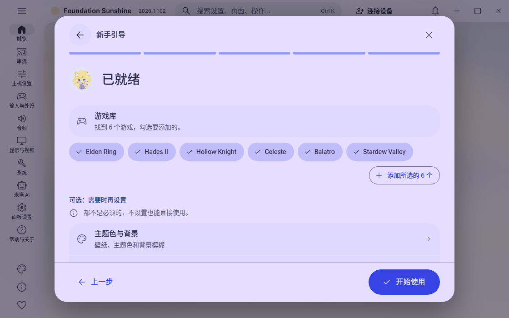

<div align="center">

# Foundation UI

Material 3 Expressive tokens, styles and Vue 3 components for the Foundation control panel and the Foundation Sunshine Web UI.

[](LICENSE)
[](https://vuejs.org)
[](https://nodejs.org)

**English** · [简体中文](README.zh-CN.md)

</div>

<picture>
  <source media="(prefers-color-scheme: dark)" srcset="docs/images/gallery-dark.png">
  
</picture>

<picture>
  <source media="(prefers-color-scheme: dark)" srcset="docs/images/guide-dark.png">
  
</picture>

The first-run guide ends on a page that finds the game library and lists what can be set later.

## Features

- **Theme and tokens** – colour schemes generated from one seed per theme with HCT (`@material/material-color-utilities`), light and dark, five scheme variants, three colour styles, contrast levels, a black-surface option and dynamic colour from an image. Shape, type (Roboto Flex) and spring motion tokens, with springs turned into CSS `linear()` easing.
- **Components** – 212 Vue 3 components: buttons, chips, switches, sliders, dialogs, sheets, menus, navigation, lists, charts and tiles, plus the pages and cards of Foundation Panel and the Web UI. Material Web (`@material/web`) supplies text fields, select, checkbox, radio and menu.
- **Skins** – CSS for the legacy Bootstrap and Element Plus controls, so older pages follow the same theme.
- **Tray and context menu models** – the data behind the tray menu, the quick panel and the window-wide context menu, with their layouts, items and popup placement.
- **Settings and diagnostics models** – settings model and search index, reachability and network overview, display and virtual-display models, update, announcements, error report and usage statistics choices, doctor and diagnostics.
- **Locales** – 18 interface locales and a locale preference helper.
- **Testing helpers** – a no-network guard, a Vue script scope checker, a selected-state style checker and a copy linter, importable by the apps that consume this package.

## Installation

Foundation UI is not published to npm. Clone it next to the application as `ds5-ui-m3e` and install its dependencies there:

```sh
git clone https://github.com/AlkaidLab/foundation-ui ../ds5-ui-m3e
npm --prefix ../ds5-ui-m3e ci
```

Reference it from the application's `package.json`:

```json
{
  "dependencies": {
    "foundation-ui": "file:../ds5-ui-m3e",
    "vue": "^3.5.0"
  }
}
```

A checkout under another name or path works the same way when `FOUNDATION_UI_DIR` points at it, for build scripts that read that variable (Foundation Panel and the Foundation Sunshine Web UI do).

Vue 3.5 or newer is a peer dependency.

## Quick start

Compile `md-*` tags as custom elements (Material Web), for example in `vite.config.js`:

```js
import vue from '@vitejs/plugin-vue'

export default {
  plugins: [vue({ template: { compilerOptions: { isCustomElement: (tag) => tag.startsWith('md-') } } })],
}
```

Then import the styles, apply a theme and use components:

```js
// main.js
import { createApp } from 'vue'
import 'foundation-ui/all.css'
import { applyTheme } from 'foundation-ui/theme'
import App from './App.vue'

applyTheme(document.documentElement) // brand seeds; both schemes, chosen by data-bs-theme="light" | "dark"
createApp(App).mount('#app')
```

```vue
<script setup>
import { ref } from 'vue'
import { MPage, MSection, MGroup, MSwitchItem, MButton } from 'foundation-ui/vue'

const rumble = ref(true)
</script>

<template>
  <MPage title="Gamepad">
    <MSection title="Haptics">
      <MGroup>
        <MSwitchItem v-model="rumble" icon="mobile_vibrate" title="Rumble" text="Game vibration reaches the controller" />
      </MGroup>
    </MSection>
    <MButton variant="tonal" icon="restart_alt">Reset</MButton>
  </MPage>
</template>
```

More in [Getting started](docs/en/getting-started.md).

## Documentation

| | |
| --- | --- |
| [Getting started](docs/en/getting-started.md) | Install, build setup, first page |
| [Theming and tokens](docs/en/theming-and-tokens.md) | Seeds, variants, dark mode, motion, fonts |
| [Components](docs/en/components.md) | Every component exported by `foundation-ui/vue` |
| [Testing](docs/en/testing.md) | `foundation-ui/testing/*` helpers and the no-network loader |

Design notes for individual areas (tile kit, home dashboard, tray, announcements, error reports and usage statistics, copy style and more) are in [`docs/`](docs).

## Development

```sh
npm ci
npm test                                                          # node:test suite
npx vite --config gallery/vite.config.js                          # gallery on http://127.0.0.1:18081
```

The gallery has one entry page per area (`gallery/*.html`); add `?theme=dark` for the dark scheme. Node 20 or newer is required. Some tests are skipped unless `HOST_README` points at the Foundation Sunshine README.

`src/tokens/tokens.css` and `springs.css` are generated: `npm run build:tokens`. Icons are generated from Material Symbols: `npm run build:icons`.

## Compatibility

- Vue 3.5 or newer.
- Evergreen browsers and WebView2: Foundation Panel renders it in a WebView2 window, and the Foundation Sunshine Web UI runs in the browsers of the machines that open it. Spring motion relies on CSS `linear()` easing. Legacy browsers are not supported.
- ES modules only (`"type": "module"`); the package is consumed from source by a bundler such as Vite.

## Projects using Foundation UI

- [Foundation Panel](https://github.com/AlkaidLab/foundation-panel)
- [Foundation Sunshine](https://github.com/AlkaidLab/foundation-sunshine) Web UI

## Contributing

Issues and pull requests are welcome.

1. Fork, create a branch, and keep a change to one subject.
2. Run `npm ci && npm test` before opening a pull request; add a test for new behaviour.
3. Interface text follows [`docs/copy-style.zh.md`](docs/copy-style.zh.md); `npm test` runs the copy lint.
4. Do not add network calls to tests: the loader in `scripts/no-network.mjs` fails the run when a test reaches the real release hosts.

## Licence

[MPL-2.0](LICENSE). Modified files of this package stay under MPL-2.0; applications that use it keep their own licence.

Bundled third-party material: `@material/web`, `@material/material-color-utilities`, Material Symbols and the values taken from Material Components for Android are Apache-2.0. The fonts in `src/fonts` are SIL OFL 1.1; each licence text sits beside the files, see [`src/fonts/FONTS.md`](src/fonts/FONTS.md).
