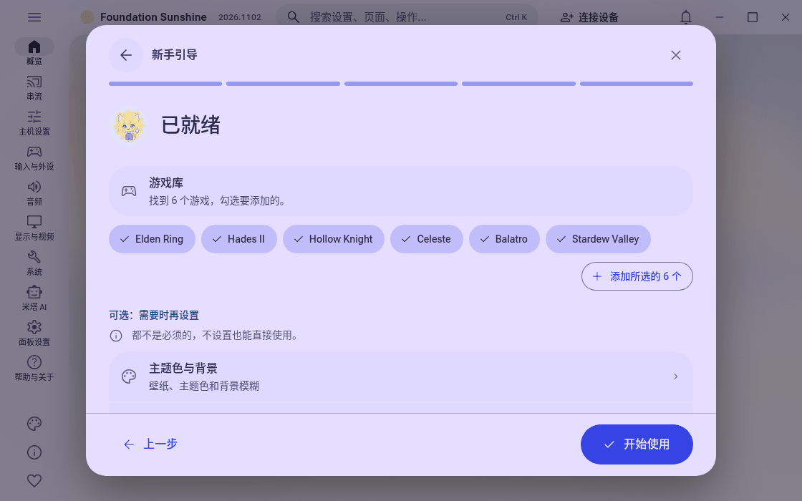

<div align="center">

# Foundation UI

Material 3 Expressive 令牌、样式与 Vue 3 组件，供 Foundation 控制面板和 Foundation Sunshine 的 Web UI 使用。

[](LICENSE)
[](https://vuejs.org)
[](https://nodejs.org)

[English](README.md) · **简体中文**

</div>

<picture>
  <source media="(prefers-color-scheme: dark)" srcset="docs/images/gallery-dark.png">
  
</picture>

<picture>
  <source media="(prefers-color-scheme: dark)" srcset="docs/images/guide-dark.png">
  
</picture>

首次运行引导的完成页会找出游戏库，并列出之后可以再设置的内容。

## 特性

- **主题与令牌**：以 HCT（`@material/material-color-utilities`）从每个主题的一个种子色生成配色，支持亮色与暗色、五种配色方案、三种配色风格、对比度档位、纯黑表面选项，以及从图片取色。另有形状、字体（Roboto Flex）与弹簧动效令牌，弹簧动效转换为 CSS `linear()` 缓动。
- **组件**：212 个 Vue 3 组件，包括按钮、标签、开关、滑块、对话框、面板、菜单、导航、列表、图表与磁贴，以及 Foundation 面板和 Web UI 的各功能页与卡片。文本框、下拉选择、复选框、单选框与菜单由 Material Web（`@material/web`）提供。
- **旧控件皮肤**：为 Bootstrap 与 Element Plus 控件提供样式，旧页面同样跟随主题。
- **托盘与右键菜单模型**：托盘菜单、快捷面板与全窗口右键菜单背后的数据，含布局、条目与弹窗定位。
- **设置与诊断模型**：设置模型与搜索索引、可达性与网络概览、显示器与虚拟显示器模型、更新、公告、错误报告与使用统计开关、体检与诊断。
- **多语言**：18 种界面语言，以及语言偏好工具。
- **测试辅助**：无网络守卫、Vue 脚本作用域检查、选中态样式检查与文案 lint，可由使用本包的应用直接导入。

## 安装

Foundation UI 未发布到 npm。把它克隆到应用旁边，命名为 `ds5-ui-m3e`，并在该目录安装依赖：

```sh
git clone https://github.com/AlkaidLab/foundation-ui ../ds5-ui-m3e
npm --prefix ../ds5-ui-m3e ci
```

在应用的 `package.json` 中引用：

```json
{
  "dependencies": {
    "foundation-ui": "file:../ds5-ui-m3e",
    "vue": "^3.5.0"
  }
}
```

检出在其他名称或路径时，把 `FOUNDATION_UI_DIR` 指向它即可，适用于读取该变量的构建脚本（Foundation 面板与 Foundation Sunshine Web UI 均如此）。

需要 Vue 3.5 或更新版本（peer 依赖）。

## 快速开始

把 `md-*` 标签编译为自定义元素（Material Web），例如在 `vite.config.js` 中：

```js
import vue from '@vitejs/plugin-vue'

export default {
  plugins: [vue({ template: { compilerOptions: { isCustomElement: (tag) => tag.startsWith('md-') } } })],
}
```

然后引入样式、应用主题并使用组件：

```js
// main.js
import { createApp } from 'vue'
import 'foundation-ui/all.css'
import { applyTheme } from 'foundation-ui/theme'
import App from './App.vue'

applyTheme(document.documentElement) // 默认种子色；亮暗两套配色由 data-bs-theme="light" | "dark" 选择
createApp(App).mount('#app')
```

```vue
<script setup>
import { ref } from 'vue'
import { MPage, MSection, MGroup, MSwitchItem, MButton } from 'foundation-ui/vue'

const rumble = ref(true)
</script>

<template>
  <MPage title="手柄">
    <MSection title="触觉与震动">
      <MGroup>
        <MSwitchItem v-model="rumble" icon="mobile_vibrate" title="启用震动" text="游戏发出的震动会传到手柄" />
      </MGroup>
    </MSection>
    <MButton variant="tonal" icon="restart_alt">恢复默认</MButton>
  </MPage>
</template>
```

更多见[快速开始](docs/zh-CN/getting-started.md)。

## 文档

| | |
| --- | --- |
| [快速开始](docs/zh-CN/getting-started.md) | 安装、构建配置、第一个页面 |
| [主题与令牌](docs/zh-CN/theming-and-tokens.md) | 种子色、配色方案、暗色模式、动效、字体 |
| [组件](docs/zh-CN/components.md) | `foundation-ui/vue` 导出的全部组件 |
| [测试](docs/zh-CN/testing.md) | `foundation-ui/testing/*` 辅助工具与无网络加载器 |

各功能的设计说明（磁贴套件、首页仪表盘、托盘、公告、错误报告与使用统计、文案风格等）位于 [`docs/`](docs)。

## 开发

```sh
npm ci
npm test                                                          # node:test 测试集
npx vite --config gallery/vite.config.js                          # 画廊：http://127.0.0.1:18081
```

画廊为每个功能区提供一个入口页（`gallery/*.html`），加 `?theme=dark` 查看暗色。需要 Node 20 或更新版本。部分测试需要 `HOST_README` 指向 Foundation Sunshine 的 README，否则跳过。

`src/tokens/tokens.css` 与 `springs.css` 为生成文件：`npm run build:tokens`。图标由 Material Symbols 生成：`npm run build:icons`。

## 兼容性

- Vue 3.5 或更新版本。
- 现代浏览器与 WebView2：Foundation 面板在 WebView2 窗口中渲染，Foundation Sunshine 的 Web UI 在访问它的设备浏览器中运行。弹簧动效依赖 CSS `linear()` 缓动，不支持旧版浏览器。
- 仅 ES 模块（`"type": "module"`），以源码形式由 Vite 等打包工具使用。

## 使用 Foundation UI 的项目

- [Foundation 面板](https://github.com/AlkaidLab/foundation-panel)
- [Foundation Sunshine](https://github.com/AlkaidLab/foundation-sunshine) 的 Web UI

## 参与贡献

欢迎提交 Issue 与 Pull Request。

1. Fork 后新建分支，一次改动只做一件事。
2. 提交 PR 前运行 `npm ci && npm test`；新增行为请补充测试。
3. 界面文案遵循 [`docs/copy-style.zh.md`](docs/copy-style.zh.md)，`npm test` 会运行文案 lint。
4. 测试不得访问网络：`scripts/no-network.mjs` 在测试触达真实发布主机时让运行失败。

## 许可证

[MPL-2.0](LICENSE)。本包中被修改的文件保持 MPL-2.0；使用它的应用保留自己的许可证。

随附的第三方内容：`@material/web`、`@material/material-color-utilities`、Material Symbols 以及取自 Material Components for Android 的数值为 Apache-2.0；`src/fonts` 中的字体为 SIL OFL 1.1，许可证文本与字体文件放在一起，见 [`src/fonts/FONTS.md`](src/fonts/FONTS.md)。
